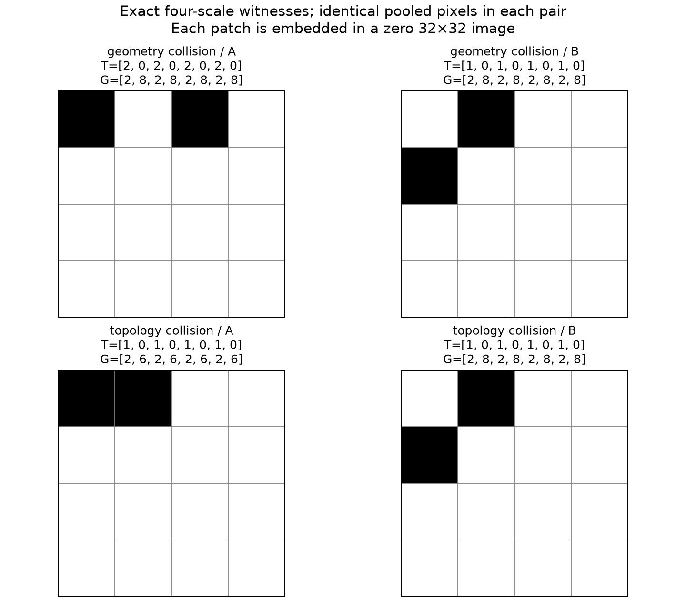

# Числа Бетти против площадей и периметров: что объясняет теория информации

**Вывод. Формально обосновать механизм выигрыша можно, но общее утверждение «в числах Бетти сохраняется больше информации» неверно.** Для нашей задачи нужно различать информацию о метке цифры, доступную идеальному предсказателю, и информацию, которую удаётся использовать сети с 508 параметрами. Для точного набора признаков из репозитория построены примеры строгого преимущества в обе стороны. На реальных сохранённых моделях установлен меньший условный логарифмический лосс с числами Бетти; порядок истинных взаимных информаций распределения OptDigits этим не установлен.

## 1. Какие случайные величины сравниваются

Пусть (U) — исходное бинарное изображение (32\times32), (Y\in\{0,\dots,9\}) — метка, (X=x(U)\in\mathbb R^{64}) — средние по блокам (4\times4), (T=t(U)\in\mathbb R^8) — пары чисел Бетти для радиусов замыкания (0,1,2,3), а (G=g(U)\in\mathbb R^8) — площади и периметры тех же масок. Модели получают (Z_T=(X,T)) и (Z_G=(X,G)), с описанной в коде стандартизацией. Здесь коэффициент дополнительных признаков равен 1. Все логарифмы в теоретических формулах имеют основание 2.

Оба представления вычисляются из одного (U). Детерминированная обработка не добавляет информацию о (Y) к полному (U). Однако (T) и (G) могут сохранять разные сведения, потерянные при переходе к (X). Сравнивать следует (I(Y;T\mid X)) и (I(Y;G\mid X)), а не энтропии (H(T)) и (H(G)). Стандартные определения и неравенство обработки данных изложены в [лекциях Polyanskiy и Wu, главы 2–3](https://ocw.mit.edu/courses/6-441-information-theory-spring-2016/pages/lecture-notes/).

## 2. Точное равенство для идеальных предсказателей

Определим оптимальный ожидаемый логарифмический лосс

\[
L^*(Z)=\inf_q\mathbb E[-\log_2 q(Y\mid Z)].
\]

Здесь минимум берётся по всем условным распределениям, без ограничения архитектуры. Для любого (q)

\[
\mathbb E[-\log_2q(Y\mid Z)]
=H(Y\mid Z)+\mathbb E_Z D_{\rm KL,2}\bigl(P(Y\mid Z)\Vert q(Y\mid Z)\bigr).
\]

Последнее слагаемое неотрицательно и равно нулю при истинном условном распределении. Поэтому (L^*(Z)=H(Y\mid Z)). Отсюда непосредственно:

\[
\boxed{L^*(X,G)-L^*(X,T)
=I(Y;T\mid X)-I(Y;G\mid X).}
\tag{1}
\]

Это точная формализация гипотезы «топология сохраняет больше полезной для метки информации». Связь выигрыша от дополнительных наблюдений с условной взаимной информацией и логарифмическим лоссом рассматривается в [Jiao, Courtade, Venkat, Weissman, 2015](https://arxiv.org/abs/1403.4679). Равенство (1) здесь получено непосредственно для двух представлений нашего эксперимента.

**Достаточное условие.** Если

\[
Y\perp G\mid(X,T),
\]

то площади и периметры не сообщают о метке ничего дополнительного после (X,T). По цепному правилу

\[
I(Y;T\mid X)-I(Y;G\mid X)
=I(Y;T\mid X,G)-I(Y;G\mid X,T),
\]

и потому

\[
L^*(X,G)-L^*(X,T)=I(Y;T\mid X,G)\ge0.
\tag{2}
\]

Выигрыш строгий, если правая часть положительна. Более общий приближённый вариант: если (I(Y;G\mid X,T)\le\varepsilon), то выигрыш не меньше (I(Y;T\mid X,G)-\varepsilon).

Условная независимость — содержательное предположение о распределении изображений и меток. **Для OptDigits мы его не доказали.** Сам факт, что признаки топологические, его не обеспечивает. Например, одинаковое число отверстий встречается у разных цифр. Также многомасштабный вектор (T) содержит результаты метрически заданного замыкания: его инвариантность относительно произвольных деформаций исходного изображения не предполагается.

## 3. Связь с accuracy требует дополнительного внимания

Большая взаимная информация гарантирует меньший *оптимальный log-loss*, но сама по себе не упорядочивает оптимальную accuracy. Проверяемый пример: равновероятная бинарная метка, наблюдение A сообщает её точно с вероятностью 0.7 и стирает с вероятностью 0.3; наблюдение B переворачивает её с вероятностью 0.1. Тогда

\[
I(Y;A)=0.7>1-h_2(0.1)\approx0.531,
\]

но оптимальная accuracy равна 0.85 для A и 0.90 для B.

При более сильном условии из (2) можно доказать и неухудшение байесовской accuracy. Действительно,

\[
P(Y=y\mid X,G)=\mathbb E[P(Y=y\mid X,T)\mid X,G].
\]

В силу выпуклости максимума

\[
\mathbb E\max_yP(Y=y\mid X,G)
\le\mathbb E\max_yP(Y=y\mid X,T).
\]

Строгий выигрыш accuracy требует, чтобы усреднение действительно меняло оптимальное решение: изменение вероятностей без изменения наиболее вероятного класса может уменьшить энтропию, сохранив accuracy. И это утверждение относится к байесовским решениям, а не к гарантированному результату конкретного запуска AdamW.

## 4. Строгий пример для наших 64 + 8 признаков

Следующие патчи помещаются в один блок (4\times4) на позициях строк/столбцов 12–15 нулевого изображения (32\times32). Матрицы ниже показывают весь патч; единица — активный пиксель.

\[
A=\begin{pmatrix}1&0&1&0\\0&0&0&0\\0&0&0&0\\0&0&0&0\end{pmatrix},\qquad
B=\begin{pmatrix}0&1&0&0\\1&0&0&0\\0&0&0&0\\0&0&0&0\end{pmatrix}.
\]

У обоих (X) один ненулевой элемент, равный (2/16=1/8). У A два раздельных квадрата, у B квадраты соприкасаются вершиной и образуют одну компоненту в принятой модели замкнутых пиксельных квадратов. Площадь обоих равна 2, периметр — 8. Для **всех четырёх радиусов** точный код возвращает

\[
G(A)=G(B)=(2,8,2,8,2,8,2,8),
\]
\[
T(A)=(2,0,2,0,2,0,2,0),\quad
T(B)=(1,0,1,0,1,0,1,0).
\]

Это не только численный факт. Замыкание конечным структурным элементом остаётся внутри выпуклой оболочки исходного множества: применив любую линейную форму к включению (z+B_r\subset A+B_r), получаем ограничение опорной функции для (z\in\operatorname{conv}(A)). У диагональной пары B между концами отрезка нет других целочисленных точек. У A единственная возможная новая точка — середина; её сдвиг на ((r,0)) имеет расстояние (sqrt{r^2+1}>r) от обоих исходных пикселей, поэтому не принадлежит дилатации и не проходит эрозию. При (r=0) операция тождественна. Таким образом, рассматриваемые замыкания обе пары сохраняют.

Теперь определим распределение: U равновероятно A или B, а Y различает эти два случая. Тогда

\[
I(Y;X,G)=0,\qquad I(Y;X,T)=1\text{ бит}.
\]

Любой классификатор по (X,G) имеет accuracy не выше 50%; по (X,T) достаточно порога (eta_0>1.5), чтобы получить 100%. Такая граница реализуема и нашей MLP. Оптимальные логарифмические потери равны соответственно 1 и 0 битам; для softmax с конечными весами ноль понимается как инфимум. Это **доказательство возможного механизма** на точных признаках эксперимента, а не модель распределения рукописных цифр.

## 5. Обратный пример исключает универсальное превосходство

Возьмём

\[
C=\begin{pmatrix}1&1&0&0\\0&0&0&0\\0&0&0&0\\0&0&0&0\end{pmatrix}
\]

и ту же B. Для них одинаковы (X) и весь (T=(1,0,1,0,1,0,1,0)), но

\[
G(C)=(2,6,2,6,2,6,2,6),\qquad
G(B)=(2,8,2,8,2,8,2,8).
\]

Их замыкания также сохраняются. На равновероятной задаче различения B и C роли меняются: геометрия даёт 1 бит и 100% accuracy, топология — 0 бит и не более 50%. Следовательно, для полного пространства бинарных изображений ни (X,G) не определяется через (X,T), ни (X,T) через (X,G). Распределительно независимого порядка информативности у этих двух представлений нет.



## 6. Маленькая сеть: доступная информация

Для ограниченного семейства предсказателей (mathcal V), например MLP (72\to6\to10), вводят

\[
H_{mathcal V}(Y\mid Z)=\inf_{q\inmathcal V}\mathbb E[-\log_2q(Y\mid Z)],
\qquad
I_{mathcal V}(Z\to Y)=H(Y)-H_{mathcal V}(Y\mid Z).
\]

Здесь использовано, что семейство допускает постоянные предсказания произвольного распределения классов через выходные смещения (в пределе для нулевых вероятностей). Общая теория (mathcal V)-информации учитывает ограничения предсказателя; вычисление признаков может сделать уже имеющиеся сведения доступнее такому семейству. Это рамка [Xu, Zhao, Song, Stewart, Ermon, ICLR 2020](https://arxiv.org/abs/2002.10689).

Для наших двух фактически обученных предсказателей получаем точное разложение ожидаемого риска:

\[
L_G-L_T=
\underbrace{I(Y;T\mid X)-I(Y;G\mid X)}_{\text{разница информации по Шеннону}}
+\underbrace{D_G-D_T}_{\text{разница ошибок восстановления условных вероятностей}},
\tag{3}
\]

где

\[
D_G=\mathbb E D_{\rm KL,2}(P(Y\mid X,G)\Vert q_G),
\quad
D_T=\mathbb E D_{\rm KL,2}(P(Y\mid X,T)\Vert q_T).
\]

Последние слагаемые включают ограничения архитектуры и результат обучения по конечным данным. Они не известны нам отдельно. Можно также разложить (D_Z) на минимальную ошибку приближения внутри (mathcal V) и превышение риска обученной модели над этим инфимумом.

Поэтому меньший лосс обученной сети совместим и с большим количеством сохранённой информации о метке, и с более удобной для сети формой её представления. **Наши 20 моделей не являются доказанными глобальными оптимумами (mathcal V); разность их лоссов не равна по определению разности оптимальных (mathcal V)-информаций.** Число параметров само по себе также не проверяет условия общих теорем о статистической оценке: потребовались бы контроль класса функций и соответствующие предположения о выборке.

## 7. Проверка на реальных сохранённых предсказаниях

Использованы ранее зафиксированные модели с коэффициентом 1: обучение TRA+CV, оценка WDEP, десять инициализаций, 508 параметров. Нового обучения и выбора настроек здесь не было. Лосс пересчитан из сохранённых логитов через устойчивый logsumexp в float64, без обрезания вероятностей. Совпадение с архивным CE проверено с допуском (5\cdot10^{-8}) натов.

| Модель | Средняя accuracy WDEP | CE, наты | Log-loss, биты на метку |
|---|---:|---:|---:|
| Пиксели + площади/периметры | 95,334% | 0,156997 | 0,226499 |
| Пиксели + числа Бетти | 96,564% | 0,131553 | 0,189791 |

У топологической модели достигнутый log-loss меньше на **0,036708 бита на изображение**, или примерно на 16,2%. Это соответствует **34,616 бита на последовательность из 943 меток** в среднем по моделям — идеальная условная кодовая длина при известных модели и входных признаках. Стоимость передачи модели, признаков, масштабирования и вычисления топологии в эту величину не включена. Изображения этим экспериментом не сжимались.

Положительная разность лоссов есть в **9 из 10** пар инициализаций; положительная разность accuracy — в 10 из 10. Для seed 0 топология улучшила accuracy, но ухудшила log-loss. Это практическое напоминание, что две метрики различаются. В качестве фиксированного предсказателя без изображения использованы частоты классов из TRA+CV: его лосс WDEP равен 3,325943 бита. Выигрыш относительно него составил 3,099444 и 3,136152 бита соответственно; это также достигнутые выигрыши конкретных предсказателей.

WDEP уже использовалась в исследовании, а её авторы почерка представлены в обучении. Эти числа являются описанием сохранённого эксперимента. Они не устанавливают точное значение популяционной взаимной информации, статистическую значимость нового механизма или обобщение на новых авторов.

## 8. Почему непосредственная частотная оценка MI здесь обманчива

Для TRA+CV получено:

| Признаки | Различных векторов среди 2880 | Эмпирическая энтропия признаков, бит | Частотная MI с меткой, бит | MI после случайной перестановки меток, среднее 200 перестановок |
|---|---:|---:|---:|---:|
| X: 64 средних пикселя | 2880 | 11,491853 | 3,321199 | 3,321199 |
| G: 8 площадей/периметров | 2880 | 11,491853 | 3,321199 | 3,321199 |
| T: 8 чисел Бетти | 63 | 2,755494 | 1,195414 | 0,112087 |

У каждого X и G только одно наблюдение. В эмпирическом распределении их значения служат уникальными идентификаторами изображения; метка восстанавливается таблицей соответствий даже после произвольной перестановки меток. Поэтому (widehat H(Y\mid G)=0) и (widehat I(Y;G)=widehat H(Y)). Эта оценка не обнаруживает потери предсказательной структуры при перемешивании меток.

Более того, X уникален на объединении всех 3823 наблюдаемых TRA+CV+WDEP изображений. Следовательно, на этом эмпирическом распределении одновременно

\[
\widehat I(Y;T\mid X)=\widehat I(Y;G\mid X)=0.
\]

Это точное свойство эмпирического распределения, **не утверждение о неизвестном распределении новых изображений**. Оно показывает, почему нельзя обосновать наш выигрыш прямым подсчётом частот полных 64- или 72-мерных векторов. У T повторяющиеся значения и заметная связь с настоящими метками по сравнению с перестановками, но это тоже не доказывает большего (I(Y;T\mid X)) относительно геометрии.

## 9. Коэффициент 0,3 против 1: дополнительная формальная проверка смысла

Для любого (a>0) отображение ((X,T)\mapsto(X,aT)) обратимо. Поэтому оно не меняет информацию по Шеннону. Если первый слой имеет вид (A X+B T+b), при переходе ко входу (aT) достаточно заменить (B) на (B/a). При неограниченных весах семейство функций той же MLP также остаётся тем же.

Таким образом, коэффициенты 0,3 и 1 не различаются по теоретической сохранности информации или выразительности архитектуры. Их различие в обученных результатах связано с параметризацией, оптимизацией, регуляризацией и конечным обучением. Это ещё одна причина не приравнивать измеренный лосс конкретного запуска к количеству информации по Шеннону.

## 10. Что можно утверждать в статье

Корректная формулировка по уже имеющимся данным:

> При фиксированной архитектуре MLP с 508 параметрами замена площадей и периметров числами Бетти уменьшает достигнутый log-loss на WDEP на 0,0367 бита на метку. Это согласуется с гипотезой, что топологические признаки делают информацию о классе более доступной для малой сети. Построены точные примеры изображений, для которых числа Бетти сохраняют различие, полностью теряемое геометрическим представлением, и обратные примеры. Неравенство истинных взаимных информаций для распределения OptDigits экспериментом не установлено.

Для отдельного исследования механизма полезно условное сравнение предсказателей по (X), (X,G), (X,T) и (X,G,T). Тогда можно оценивать дополнительный достигнутый выигрыш T поверх X,G и G поверх X,T, проверяя его при разных ограничениях на декодер и на заранее определённых разбиениях. Такая постановка соответствует [conditional probing, Hewitt et al., EMNLP 2021](https://arxiv.org/abs/2109.09234). Добавленные входные веса должны учитываться; оптимизационный поиск и правила выбора должны быть одинаковыми. Даже это оценивает доступную предсказателям информацию, а не автоматически истинную MI. Для популяционного утверждения потребуются дополнительные предположения и обоснование ошибки оценки.

## Воспроизведение и границы проверки

Из корня репозитория:

```bash
uv run --locked python outputs/information_betti_20261013/analyze_information.py \
  --repo . --output runs/information-betti-new
uv run --locked python outputs/information_betti_20261013/verify_evidence.py \
  --repo . --analysis runs/information-betti-new --search-holes
```

Первый скрипт отказывается перезаписывать существующий каталог. Он читает `runs/wdep-alpha1-20261011`, сверяет хеш предсказаний, пересчитывает метрики, строит частотные диагностики и ищет точные синтетические пары, вызывая исходный `scale_features`. Второй проверяет примеры через независимые операции над множествами, явно строит разделяющие MLP с 508 параметрами и проверяет компенсацию коэффициента первым слоем. Сохранены хеши источников, массивы лоссов и изображения-свидетели. В `verified_analysis` лежит проверенный запуск. Математические выводы (1)–(3) доказаны в тексте; вычислительные проверки подтверждают конкретные признаки и числа, а не неизвестные свойства распределения OptDigits.

Дополнительно проверен поиск пары с одинаковой геометрией и разным (eta_1) среди всех 65536 патчей (4\times4), ограниченных условием (eta_0=1) у исходной маски. Такая пара не найдена. Это ограниченный отрицательный результат поиска, а не доказательство невозможности на больших изображениях; положительный пример выше использует (eta_0).
