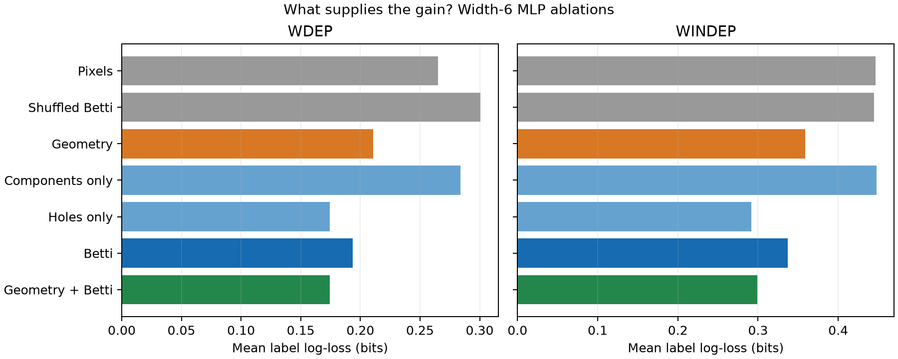
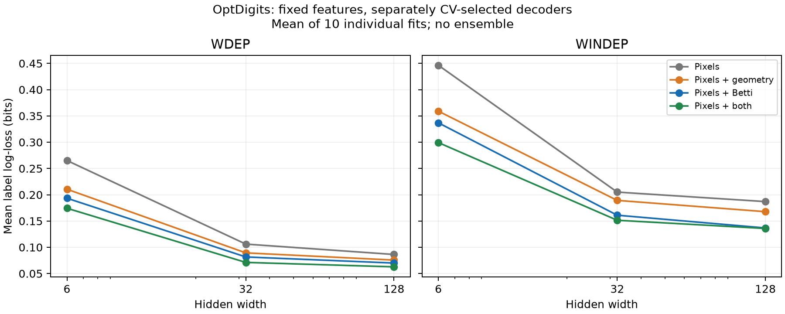

# Числа Бетти и информация о рукописной цифре: завершённое исследование

Дата: 13 октября 2026 года. Данные: оригинальный OptDigits. Выполнено 668 обучений: 510 при подборе настроек и 158 итоговых моделей. Исследование проверяет механизм ранее найденного выигрыша; научный приоритет и превосходство над всеми архитектурами не заявляются.

## Основной результат

**Числа Бетти дают дополнительный предсказательный сигнал поверх площадей и периметров при фиксированном способе обучения. Наиболее полезна часть, описывающая отверстия. Утверждение о большем количестве информации по Шеннону на распределении OptDigits этим не доказано.**

У сети с шестью скрытыми нейронами добавление всех чисел Бетти к пикселям и геометрии снизило log-loss на WINDEP с 0,35908 до 0,29929 бита на метку и повысило accuracy с 92,888% до 94,285%. Улучшение обеих метрик есть во всех десяти парах инициализаций. Для этой проверки геометрия остаётся на входе: топология помогает сверх неё.

Найден более компактный вариант: четыре числа отверстий β₁ на четырёх масштабах. Его эквивалентная сеть 68 → 6 → 10 содержит **484 параметра**, против 508 у геометрической. На WINDEP её accuracy — **94,296% против 92,888%**, разница **+1,408 п.п.**; log-loss меньше на **18,75%**. Предсказания десяти экспортированных компактных моделей побитово совпали с исходными моделями этого варианта.

## 1. Что именно измеряется

Исходное изображение U — бинарная матрица 32 × 32. X — 64 средних значения по блокам 4 × 4. Для радиусов дискового морфологического замыкания 0, 1, 2, 3 из исходного изображения вычисляются:

- G: восемь чисел — площадь и периметр каждой маски;
- T: восемь чисел — β₀ и β₁ каждой маски;
- T₀ и T₁: соответственно четыре β₀ и четыре β₁.

β₀ считает компоненты объединения замкнутых пиксельных квадратов; касание вершинами соединяет компоненты. β₁ считает ограниченные компоненты дополнения, то есть отверстия. Используется прежний неизменённый вычислитель признаков. Все дополнительные признаки получают коэффициент 1.

T и G вычисляются из U, поэтому не добавляют к полному исходному изображению новую информацию. По отношению к сжатому X они могут сохранять разные сведения. Сравнение G и T контролирует одинаковое число дополнительных координат и общий источник высокого разрешения.

## 2. Строгая математическая часть

Для метки Y и любого представления Z определим идеальный ожидаемый log-loss в битах:

\[
L^*(Z)=\inf_q\mathbb E[-\log_2 q(Y\mid Z)].
\]

Разложение перекрёстной энтропии даёт

\[
L(q;Z)=H(Y\mid Z)+\mathbb E D_{\mathrm{KL},2}(P(Y\mid Z)\Vert q(Y\mid Z)).
\]

Поэтому \(L^*(Z)=H(Y\mid Z)\), и

\[
\boxed{L^*(X,G)-L^*(X,T)=I(Y;T\mid X)-I(Y;G\mid X).}
\]

Для объединённого входа точное равенство имеет вид

\[
\boxed{L^*(X,G)-L^*(X,G,T)=I(Y;T\mid X,G)\ge0.}
\]

Это обосновывает постановку условного сравнения. Для доказательства превосходства T над G достаточно предположить \(Y\perp G\mid(X,T)\) и \(I(Y;T\mid X,G)>0\). Первое условие говорит, что геометрия после знания X,T ничего не добавляет о метке. Для OptDigits оно не установлено, и результаты объединённой модели не дают оснований объявить геометрию полностью избыточной.

У реально обученных моделей вместо идеальных потерь получаем

\[
L_G-L_T=I(Y;T\mid X)-I(Y;G\mid X)+D_G-D_T,
\]

где \(D_G,D_T\) — ошибки восстановления истинных условных вероятностей, выраженные через ожидаемую KL-дивергенцию. Они включают ограничения архитектуры, конечную обучающую выборку и результат оптимизации. Поэтому разность измеренных лоссов не равна автоматически разности взаимных информаций.

Для ограниченного семейства моделей \(\mathcal V\) можно определить

\[
H_{\mathcal V}(Y\mid Z)=\inf_{q\in\mathcal V}\mathbb E[-\log_2q(Y\mid Z)].
\]

Разность таких величин описывает преимущество представлений для выбранного семейства. Наши обученные предсказатели приближают эту постановку, но глобальная оптимальность MLP и популяционные риски не известны. Экспериментальные числа ниже названы **достигнутыми выигрышами log-loss**, а не точными значениями Shannon- или V-информации.

Связь log-loss и информации описана у [Jiao et al., 2015](https://arxiv.org/abs/1403.4679); семейства ограниченных предсказателей — у [Xu et al., 2020](https://arxiv.org/abs/2002.10689); сравнение с добавлением признака поверх базового представления — у [Hewitt et al., 2021](https://arxiv.org/abs/2109.09234). Теоретическая рамка известна; здесь проверено её применение к нашим точным признакам и данным.

## 3. Протокол и контроль сравнения

TRA: 1934 изображения для первоначального обучения; CV: 946 для выбора настроек; TRA+CV: 2880 для повторного обучения выбранных конфигураций; WDEP: 943; WINDEP: 1797. WDEP содержит авторов почерка, представленных в обучении; WINDEP — других авторов. Исходное описание датасета хранится в optdigits.zip, файл optdigits-orig.names; [страница UCI](https://archive.ics.uci.edu/dataset/80/optical+recognition+of+handwritten+digits).

Проверены четыре основных входа: X, XG, XT, XGT. Для MLP с шириной 6 дополнительно проверены XT₀, XT₁ и X с независимо перемешанными строками T. Перемешивание одинаково для всех инициализаций и выполняется отдельно внутри каждой части; метки при нём не используются.

MLP имеют один скрытый ReLU-слой ширины 6, 32 или 128. Все получают 80 входных позиций, отсутствующие признаки заменяются нулями. Это обеспечивает одну и ту же форму сети, инициализацию и порядок минибатчей при сравнении признаков. Дополнение нулями не увеличивает эффективную ёмкость: веса при нулевых входах можно удалить. Для G и T число реально используемых входов одинаково. XGT использует больше признаков и больше эффективных весов, что учтено в таблице.

Подбор MLP: LR ∈ {0,0003; 0,001; 0,003; 0,01; 0,03}, weight decay ∈ {0; 0,01}, AdamW, batch 256, три инициализации 0–2 на комбинацию. Максимум 3000 эпох, остановка после 120 эпох без улучшения CV CE. Чекпойнт выбирается по минимальному CV CE, конфигурация — по среднему CV CE трёх запусков. Ни один запуск не упёрся в максимум эпох. При повторном обучении используется медиана выбранных трёх эпох и десять новых инициализаций 10–19. Ансамбли не используются.

Линейная модель — multinomial logistic regression, шесть C от 0,001 до 100. RBF SVM — C ∈ {1,10,100}, gamma ∈ {0,001;0,01;0,1}; вероятности калибруются внутренними обучающими разбиениями. Их настройки также выбираются по CV log-loss, затем каждая конфигурация обучается один раз на TRA+CV. Accuracy SVM считается по максимуму предсказанной вероятности, согласованно с log-loss.

Стандартизация вычисляется по TRA, затем заново по TRA+CV при повторном обучении. Все 158 итоговых моделей сохранены до чтения тестовых изображений в этом запуске. Код, источники, протокол и предсказания защищены хешами. Этот запуск использует иной критерий подбора и новые инициализации по сравнению с исторической таблицей статьи; его значения следует читать как отдельный эксперимент.

## 4. Результаты маленькой сети

Усредняются метрики десяти отдельных моделей. Лосс дан в битах на метку. Число параметров в таблице — после удаления искусственно добавленных нулевых входных позиций. Все 64 пиксельных входа сохраняются по исходному соглашению подсчёта; среди них три координаты постоянны на TRA+CV.

| Вход | Параметры | WDEP accuracy, % | WDEP log-loss | WINDEP accuracy, % | WINDEP log-loss |
|---|---:|---:|---:|---:|---:|
| Пиксели | 460 | 94.560 | 0.26518 | 91.564 | 0.44643 |
| Пиксели + геометрия | 508 | 95.546 | 0.21054 | 92.888 | 0.35908 |
| Пиксели + все числа Бетти | 508 | 96.405 | 0.19341 | 93.851 | 0.33691 |
| Пиксели + геометрия + Бетти | 556 | 96.691 | 0.17431 | 94.285 | 0.29929 |
| Пиксели + четыре β₀ | 484 | 94.136 | 0.28373 | 91.569 | 0.44751 |
| Пиксели + четыре β₁ | 484 | 96.691 | 0.17420 | 94.296 | 0.29177 |
| Пиксели + перемешанные Бетти | 508 | 93.828 | 0.30073 | 91.547 | 0.44468 |

Номинально все эти MLP обучались с 556 весами и смещениями; часть входных весов была связана только с нулевыми координатами. Поле effective_parameters в JSON обозначает число параметров после удаления искусственного дополнения нулями, а не минимальную функциональную размерность модели. Компактная версия XT₁ действительно экспортирована с 484 параметрами и проверена на обоих тестах. Статистики стандартизации и вычисление признаков — отдельная стоимость, не входящая в число обучаемых параметров.



## 5. Проверка дополнительного сигнала и неопределённости

Основные два сравнения были записаны в протокол до запуска. Положительная разность означает меньший лосс правой модели. Интервалы — парный bootstrap по инициализациям и изображениям, со стратификацией изображений по цифре, 5000 повторов. Для двух основных сравнений показаны 97,5%-интервалы — поправка Бонферрони на два сравнения.

| Сравнение, WINDEP, ширина 6 | Выигрыш, бит/метку | Интервал 97,5% | Положительных пар seed |
|---|---:|---:|---:|
| Замена G на T | 0.02217 | [-0.03777; 0.06949] | 6/10 |
| Добавление T поверх G | 0.05979 | [0.01857; 0.10234] | 10/10 |

Таким образом, добавление топологии поверх геометрии устойчивее простой замены G на T. Для замены средняя accuracy лучше во всех десяти запусках WINDEP, но интервал разности log-loss содержит ноль. Улучшение accuracy и улучшение log-loss — разные утверждения.

Вторичные проверки: XT₁ против X улучшает обе метрики во всех десяти запусках на обоих тестах; X с перемешанными T не показывает устойчивого улучшения. Наличие дополнительных входов само по себе не воспроизводит полезный эффект. Прямое сравнение XT₁ с XG после просмотра результатов — исследовательское: на WINDEP выигрыш 0,06732 бита, описательный 95%-интервал [0,03377; 0,10273]; accuracy +1,408 п.п., интервал [0,696; 2,126]. По обеим метрикам положительны 9/10 пар seed.

Эти интервалы учитывают повторное использование одного изображения десятью моделями. Они **не учитывают зависимость образцов одного автора почерка**, поскольку идентификаторы авторов не доступны в использованном представлении, и не исправляют повторное обращение к тестовым наборам в истории проекта. Поэтому это описательная оценка устойчивости, а не подтверждающий тест на новой популяции авторов.

## 6. Зависимость от сложности предсказателя

| Предсказатель | Вход | WDEP accuracy, % | WDEP log-loss | WINDEP accuracy, % | WINDEP log-loss |
|---|---|---:|---:|---:|---:|
| Линейный | X | 96.501 | 0.15247 | 94.992 | 0.24288 |
| Линейный | XG | 97.455 | 0.11140 | 95.715 | 0.20355 |
| Линейный | XT | 98.197 | 0.09277 | 96.383 | 0.15766 |
| Линейный | XGT | 98.621 | 0.07896 | 96.216 | 0.16091 |
| MLP, ширина 32 | X | 97.932 | 0.10605 | 95.710 | 0.20502 |
| MLP, ширина 32 | XG | 98.229 | 0.08933 | 96.027 | 0.18924 |
| MLP, ширина 32 | XT | 98.537 | 0.08157 | 96.411 | 0.16103 |
| MLP, ширина 32 | XGT | 98.600 | 0.07120 | 96.450 | 0.15141 |
| MLP, ширина 128 | X | 98.452 | 0.08632 | 96.266 | 0.18696 |
| MLP, ширина 128 | XG | 98.473 | 0.07562 | 96.500 | 0.16776 |
| MLP, ширина 128 | XT | 98.579 | 0.06998 | 96.923 | 0.13675 |
| MLP, ширина 128 | XGT | 98.759 | 0.06275 | 96.861 | 0.13578 |
| RBF SVM | X | 98.940 | 0.09239 | 97.496 | 0.15590 |
| RBF SVM | XG | 98.834 | 0.08857 | 97.496 | 0.15065 |
| RBF SVM | XT | 98.940 | 0.08964 | 97.997 | 0.13938 |
| RBF SVM | XGT | 99.258 | 0.08574 | 98.164 | 0.13932 |



На WINDEP выигрыш замены G на T у MLP ширины 6 равен 0,02217 бита, а ширины 128 — 0,03101. Разность этих выигрышей составляет −0,00884 бита с описательным 95%-интервалом [−0,05569; 0,02916]. **Гипотеза, что эффект сильнее именно у маленьких сетей, не подтверждена.**

Линейная модель с T также лучше линейной модели с G на WINDEP: 0,15766 против 0,20355 бита. Описательный 95%-интервал разности [0,02710; 0,06596]. У RBF SVM разность меньше: 0,01127 бита, интервал [−0,00184; 0,02355]. На WDEP RBF с T чуть хуже RBF с G по log-loss. Поэтому универсального превосходства топологии для любого предсказателя здесь нет.

## 7. Проверка оптимизации линейных моделей

Чтобы результат нельзя было объяснить только неудачным локальным минимумом нейросети, отдельно проверена выпуклая задача обучения линейных предсказателей. Для матрицы входов Z и one-hot меток E её целевая функция в натах:

\[
F(W,b)=\frac1N\sum_i\mathrm{CE}(E_i,\operatorname{softmax}(Z_iW+b))
+\frac\lambda2\|W\|_F^2,\qquad\lambda=\frac1{CN}.
\]

Для любой неотрицательной Q с суммой каждой строки 1 и суммами столбцов, равными численностям классов, допустима двойственная оценка

\[
D(Q)=-\frac1N\sum_{i,c}Q_{ic}\ln Q_{ic}
-\frac1{2\lambda}\left\|\frac{Z^\top(Q-E)}N\right\|_F^2
\le \inf_{W,b}F(W,b).
\]

Она получается из сопряжённости log-sum-exp и отрицательной энтропии: минимизация по свободному b требует совпадения сумм столбцов, а минимизация квадратичного выражения по W даёт второй член. Следовательно, \(0\le F(W,b)-F^*\le F(W,b)-D(Q)\).

Построены рациональные Q со знаменателем 2⁴⁰; ограничения строк и столбцов проверены точно целочисленными операциями. Для всех четырёх линейных моделей вычисленный разрыв прямой и двойственной задач меньше 6 × 10⁻¹² ната. Значения целевых функций вычислены в float64, без интервального контроля округления: это численный сертификат практически достигнутого глобального минимума регуляризованной **обучающей** задачи. Он не является сертификатом оптимальности популяционного log-loss или оценки Shannon MI.

## 8. Почему помогает именно число отверстий

На TRA+CV число компонент отличается от единицы хотя бы на одном из четырёх масштабов только у 12 из 2880 изображений. На WINDEP таких изображений восемь из 1797. После стандартизации редкие отклонения β₀ дают координаты величиной от 20,26 до 53,66. Более того, на TRA две координаты β₀ постоянны и зануляются; при повторной стандартизации на TRA+CV они становятся непостоянными из-за редких примеров CV.

Число отверстий меняется существенно чаще: на исходных WINDEP масках β₁=0 у 1014 изображений, β₁=1 у 575, β₁=2 у 174, большие значения — у 34. Отверстие присутствует у 96,6% нулей, 96,1% шестёрок, 99,4% восьмёрок и 96,1% девяток, но только у 2,7% единиц. Это наблюдение о конкретной маске и выборке; оно не означает, что β₁ однозначно определяет цифру.

Постфактум разложена разность log-loss между XT и XT₁. На WINDEP восемь изображений с нетривиальным β₀ дают 0,02591 из общей разности 0,04515 бита — около 57%. На WDEP шесть таких изображений дают около 80% разности. Этот факт связывает ухудшение полной топологии с редкими компонентными признаками, но один разбор ошибок ещё не изолирует механизм.

При фиксированных весах XT выполнена диагностическая подмена четырёх β₀ на единицу. На WDEP изменились только 6 изображений: средний log-loss стал 0.17796 вместо 0.19341 бита, выигрыш 0.01545. Предсказания остальных изображений совпали побитово.
При фиксированных весах XT выполнена диагностическая подмена четырёх β₀ на единицу. На WINDEP изменились только 8 изображений: средний log-loss стал 0.31163 вместо 0.33691 бита, выигрыш 0.02529. Предсказания остальных изображений совпали побитово.

Подмена выбрана после анализа результатов. Она показывает чувствительность конкретных моделей к β₀ при неизменных пикселях, β₁ и весах; это не причинное утверждение о процессе написания цифр и не независимо подтверждённый новый метод предобработки.

Есть и строгий информационный вывод. T₁ — проекция полного T, поэтому по неравенству обработки данных для любого распределения

\[
\boxed{I(Y;X,T_1)\le I(Y;X,T).}
\]

Удаление β₀ **не может увеличить Shannon-информацию**, хотя в наших обученных сетях оно улучшило средние метрики. Кроме того, семейство полных MLP умеет воспроизводить модель XT₁, обнулив веса β₀. Следовательно, наблюдаемый выигрыш от удаления β₀ связан с обучением и обобщением конкретных предсказателей, а не с увеличением количества сохранённой информации или расширением множества представимых функций. Для различения влияния редкости признаков, стандартизации и оптимизатора потребовалось бы отдельное заранее спланированное исследование; здесь они не объявляются раздельно идентифицированными причинами.

## 9. Почему мы не выдаём это за измерение истинной MI

Все 5620 векторов X в четырёх частях различны. На эмпирическом распределении этих записей метку можно восстановить таблицей соответствий из одного X, поэтому

\[
\widehat H(Y\mid X)=0,\qquad
\widehat I(Y;T\mid X)=\widehat I(Y;G\mid X)=0.
\]

Тот же результат получился бы после произвольного перемешивания меток. Это точное свойство конечного эмпирического распределения, а не свидетельство, что дополнительные признаки бесполезны для новых изображений. Полный профиль T принимает 79 различных значений на всех четырёх частях. Прямой подсчёт частот высокоразмерных уникальных векторов здесь не решает задачу оценки популяционной MI.

В предыдущем теоретическом исследовании построены точные пары бинарных изображений с одинаковыми X,G и разными T, а также обратные пары с одинаковыми X,T и разными G. Тем самым универсальный порядок информативности этих представлений исключён. Те примеры используют β₀ и не выдаются за объяснение найденного здесь эффекта β₁. Доказательства и независимые проверки: [предыдущий отчёт](../information_betti_20261013/report_ru.md).

## 10. Ограничения и окончательные выводы

WDEP и WINDEP уже использовались в истории проекта. Протокол зафиксирован перед новым запуском, но не является пререгистрацией до первого знакомства с данными. Внутри этого запуска тесты не использованы для выбора LR, регуляризации, эпох или seed. Прямые сравнения XT₁ с XG/XT и диагностическая подмена β₀ помечены как анализ после получения основных результатов.

Восемь и четыре признака вычисляются внешним фиксированным алгоритмом; обучаемого топологического слоя в этом эксперименте нет. Сравнение не доказывает превосходство над лучшей возможной CNN. RBF и линейные модели получили конечные явно заданные сетки настроек. Лучший найденный LR не означает глобально оптимальный LR.

Законченный результат исследования состоит в следующем:

1. На реальных данных топологические признаки дают достигнутый выигрыш log-loss даже при сохранении геометрии на входе.
2. В малой сети основную практическую пользу дают числа отверстий; найден и экспортирован вариант с 484 параметрами и улучшением относительно геометрической модели с 508 параметрами.
3. Редкие числа компонент связаны с нестабильными предсказаниями, а вмешательство в эти входы при фиксированных весах объясняет часть лишнего лосса.
4. Преимущество, специфичное именно для маленьких сетей, не установлено. Эффект есть и у линейного предсказателя, чья выпуклая обучающая задача решена практически до глобального минимума.
5. Более высокую Shannon MI для распределения OptDigits мы не установили. Доказано другое: удаление части T не может увеличить MI, хотя улучшает полученное качество. Поэтому объяснение через доступность признаков для конкретного обучения точнее, чем безусловная фраза «в числах Бетти больше информации».

## Воспроизведение и сохранённые материалы

Из корня репозитория, в новый каталог:

```bash
uv run --locked python outputs/information_probes_20261013/run_study.py --repo . --run runs/information-probes-repeat --workers 4
uv run --locked python outputs/information_probes_20261013/analyze_study.py --run runs/information-probes-repeat
uv run --locked python outputs/information_probes_20261013/audit_study.py --repo . --run runs/information-probes-repeat
uv run --locked python outputs/information_probes_20261013/formal_checks.py --run runs/information-probes-repeat
uv run --locked python outputs/information_probes_20261013/mechanism_diagnostics.py --run runs/information-probes-repeat
```

При повторном запуске того же каталога основной скрипт проверяет протокол и хеши и возобновляет уже выполненные задания. При изменённом исходном коде нужен новый каталог. Точная версия скрипта, использованная для архивных 668 обучений, сохранена в run/runner_frozen.py. В поставляемом run_study.py после эксперимента исправлено только возобновление работы и порядок сохранения выбранных конфигураций; вычисления обучения не менялись. Новый запуск автоматически сохраняет собственную копию исходника. Датасет уже находится в work/real_data/optdigits.zip; сеть для загрузки данных не требуется. Зависимости зафиксированы pyproject.toml и uv.lock.

Сохранены: protocol.json, selection.json, все 510 чекпойнтов подбора, 158 итоговых моделей, кривые обучения, предсказания, индивидуальные лоссы, результаты bootstrap, таблицы, рисунки, рациональные двойственные свидетельства и 10 компактных моделей. Исторические результаты и main.tex этим исследованием не изменялись.

Независимый проверяющий скрипт заново вычислил стандартизацию, проверил выбор всех конфигураций на CV, хеши и порядок «фиксация весов → чтение тестов». Повторный расчёт **826 массивов предсказаний совпал побитово**, максимальная ошибка логитов 0. Для компактных моделей предсказания также совпали точно. Все 36 предупреждений при подборе относятся к объявленному устареванию API SVC(probability=True) в зафиксированной версии sklearn; предупреждений о сходимости не было.

