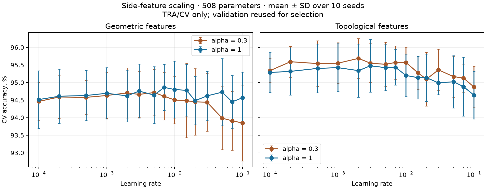

# Коэффициент дополнительных признаков: 0.3 против 1

Вход: [64 стандартизованных пиксельных признака; α × 8 стандартизованных дополнительных признаков]. Сравниваются α=0.3 и α=1. α фиксирован и не обучается. Обе MLP имеют 508 параметров и архитектуру 72→6→10.

Свежих обучений: 600 = 2 коэффициента × 2 представления × 15 learning rate × 10 инициализаций.
Данные: TRA 1934 изображения для обучения и стандартизации, CV 946 изображений для выбора чекпойнта и LR. WDEP и WINDEP не распаковывались. CV ранее использовалась, поэтому результаты являются дополнительным валидационным подбором.

AdamW, weight decay 0.01, batch size 256; максимум 6000 эпох и patience 150. Чекпойнт — минимум CV cross-entropy; LR — максимум средней CV accuracy, затем минимум средней CE и меньший LR. Начальные веса, порядок батчей и правила обучения одинаковы для обеих величин α при фиксированных seed и LR.

## Результаты после отдельного подбора LR

| Модель | α | Лучший проверенный LR | Средняя CV accuracy, % | SD, п.п. | Медиана выбранной эпохи |
|---|---:|---:|---:|---:|---:|
| Геометрическая | 0.3 | 0.005 | 94.715 | 0.659 | 65.5 |
| Геометрическая | 1 | 0.007 | 94.863 | 0.656 | 47 |
| Топологическая | 0.3 | 0.002 | 95.687 | 0.563 | 163.5 |
| Топологическая | 1 | 0.003 | 95.476 | 0.750 | 94 |

Геометрическая: изменение accuracy при α=1 вместо α=0.3 после отдельного подбора LR — +0.148 п.п.; положительных пар по seed 5/10.

Топологическая: изменение accuracy при α=1 вместо α=0.3 после отдельного подбора LR — -0.211 п.п.; положительных пар по seed 4/10.

SD показывает разброс по инициализациям, а не доверительный интервал качества на новых данных. Сравнения после подбора LR оценены на той же CV; отдельного утверждения о статистической значимости не делается.

## Замена только коэффициента при прежних выбранных LR

| Модель | Фиксированный LR | α=0.3, accuracy % | α=1, accuracy % | Разность, п.п. |
|---|---:|---:|---:|---:|
| Геометрическая | 0.005 | 94.715 | 94.641 | -0.074 |
| Топологическая | 0.002 | 95.687 | 95.338 | -0.349 |

Правило выбора эпохи одинаково, но выбранные эпохи могут различаться между коэффициентами.

## Вся сетка

| LR | Геометрия α=0.3 | Геометрия α=1 | Δ геометрии, п.п. | Топология α=0.3 | Топология α=1 | Δ топологии, п.п. |
|---:|---:|---:|---:|---:|---:|---:|
| 0.0001 | 94.461 | 94.514 | +0.053 | 95.338 | 95.285 | -0.053 |
| 0.0002 | 94.588 | 94.609 | +0.021 | 95.592 | 95.317 | -0.275 |
| 0.0005 | 94.577 | 94.630 | +0.053 | 95.539 | 95.402 | -0.137 |
| 0.001 | 94.630 | 94.693 | +0.063 | 95.550 | 95.423 | -0.127 |
| 0.002 | 94.704 | 94.619 | -0.085 | 95.687 | 95.338 | -0.349 |
| 0.003 | 94.662 | 94.757 | +0.095 | 95.550 | 95.476 | -0.074 |
| 0.005 | 94.715 | 94.641 | -0.074 | 95.518 | 95.423 | -0.095 |
| 0.007 | 94.609 | 94.863 | +0.254 | 95.571 | 95.433 | -0.137 |
| 0.01 | 94.503 | 94.799 | +0.296 | 95.571 | 95.201 | -0.370 |
| 0.015 | 94.482 | 94.778 | +0.296 | 95.275 | 95.137 | -0.137 |
| 0.02 | 94.450 | 94.482 | +0.032 | 95.095 | 95.137 | +0.042 |
| 0.03 | 94.440 | 94.619 | +0.180 | 95.359 | 94.989 | -0.370 |
| 0.05 | 93.985 | 94.725 | +0.740 | 95.169 | 95.021 | -0.148 |
| 0.07 | 93.911 | 94.450 | +0.539 | 95.127 | 94.884 | -0.243 |
| 0.1 | 93.848 | 94.567 | +0.719 | 94.873 | 94.641 | -0.233 |

## Сохраняется ли преимущество топологии

- При α=0.3: разность топология − геометрия после отдельного подбора LR +0.973 п.п.; при одинаковом LR топология лучше в среднем в 15/15 случаях.
- При α=1: разность топология − геометрия после отдельного подбора LR +0.613 п.п.; при одинаковом LR топология лучше в среднем в 15/15 случаях.

## Аудит

- Повторно загружены и проверены все 600 моделей; вероятности и метрики совпадают точно.
- Начальные веса совпадают для каждого seed между всеми представлениями, коэффициентами и LR.
- Для α=0.3 полностью совпали с предыдущим экспериментом 300 наборов вероятностей и кривых обучения.
- Запусков, остановленных ограничением числа эпох: 0.
- Выбранный LR на границе диапазона: {'0.3': {'geometry': False, 'topology': False}, '1.0': {'geometry': False, 'topology': False}}.



## Воспроизведение

Из корня репозитория:

```bash
uv run --locked python compare_feature_scale.py --workers 4
```

Новый запуск создаёт отдельный каталог runs/feature-scale-ДАТА. Повторная запись в существующий каталог запрещена без --resume. Все модели, вероятности, кривые, нормализованные входы и протокол сохранены вместе с результатами.
