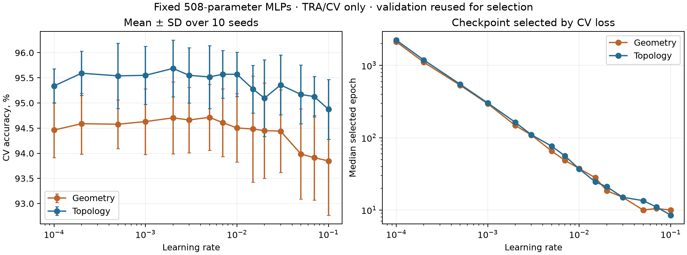

# Подбор learning rate для двух MLP на 508 параметров

Только TRA (1934) и CV (946); WDEP и WINDEP не распаковывались. Это дополнительный подбор на уже использованной валидации, а не независимая оценка качества.

Проверено 15 значений learning rate × 2 модели × 10 инициализаций = 300 обучений.
Архитектура 72→6→10, AdamW, weight decay 0.01, batch size 256; максимум 6000 эпох, patience 150.
Чекпойнт выбирается по минимуму CV cross-entropy; learning rate — по средней CV accuracy, затем средней cross-entropy. Стандартизация обучается только на TRA. Наборы значений, инициализации, порядок батчей и правила остановки одинаковы для двух представлений.

| Модель | Лучший проверенный LR | CV accuracy, % | SD по инициализациям, п.п. | Медиана выбранной эпохи |
|---|---:|---:|---:|---:|
| Геометрия | 0.005 | 94.715 | 0.659 | 65.5 |
| Топология | 0.002 | 95.687 | 0.563 | 163.5 |

Разность выбранных конфигураций: +0.973 п.п. на CV. Это оценка после выбора по той же CV, без утверждения о значимости или новом тестовом результате.

## Вся сетка

| LR | Геометрия: CV accuracy, % | Топология: CV accuracy, % | Разность, п.п. |
|---:|---:|---:|---:|
| 0.0001 | 94.461 | 95.338 | +0.877 |
| 0.0002 | 94.588 | 95.592 | +1.004 |
| 0.0005 | 94.577 | 95.539 | +0.962 |
| 0.001 | 94.630 | 95.550 | +0.920 |
| 0.002 | 94.704 | 95.687 | +0.983 |
| 0.003 | 94.662 | 95.550 | +0.888 |
| 0.005 | 94.715 | 95.518 | +0.803 |
| 0.007 | 94.609 | 95.571 | +0.962 |
| 0.01 | 94.503 | 95.571 | +1.068 |
| 0.015 | 94.482 | 95.275 | +0.793 |
| 0.02 | 94.450 | 95.095 | +0.645 |
| 0.03 | 94.440 | 95.359 | +0.920 |
| 0.05 | 93.985 | 95.169 | +1.184 |
| 0.07 | 93.911 | 95.127 | +1.216 |
| 0.1 | 93.848 | 94.873 | +1.025 |

## Проверка влияния продолжительности обучения

Для каждого свежего обучения дополнительно сохранён результат по старому правилу: максимум 250 эпох и patience 30. Это тот же начальный участок обучения с теми же весами и батчами, без отдельного повторного обучения.

| Режим | LR геометрии | Accuracy геометрии, % | LR топологии | Accuracy топологии, % |
|---|---:|---:|---:|---:|
| Вся сетка, старое правило остановки | 0.005 | 94.715 | 0.002 | 95.687 |
| Вся сетка, длинное обучение | 0.005 | 94.715 | 0.002 | 95.687 |
| Только 0.003/0.01, длинное обучение | 0.003 | 94.662 | 0.01 | 95.571 |

## Проверки и ограничения

- Все 300 сохранённых моделей повторно загружены; вероятности и метрики пересчитаны точно.
- 12 результатов по старому правилу побитово совпали с историческими вероятностями на CV.
- Начальные веса совпадают между обеими моделями и всеми learning rate для каждого seed.
- Обучений, дошедших до ограничения числа эпох: 0.
- Выбранный LR на границе диапазона: {'geometry': False, 'topology': False}.
- SD характеризует разброс по инициализациям; это не доверительный интервал качества на новых данных.
- WDEP и WINDEP ранее использовались в исследовании; этот запуск не делает их снова независимыми тестами.
- Оптимальность установлена только среди проверенных значений на данной CV при фиксированных остальных настройках.



## Воспроизведение

Из корня репозитория:

```bash
uv run --locked python tune_learning_rate.py --workers 4
```

Каждый запуск создаёт новую папку runs/lr-search-ДАТА. Для возобновления укажите тот же --output и --resume. Протокол, его исходный код, входные массивы, все чекпойнты, кривые, вероятности и аудит сохранены в папке запуска.
